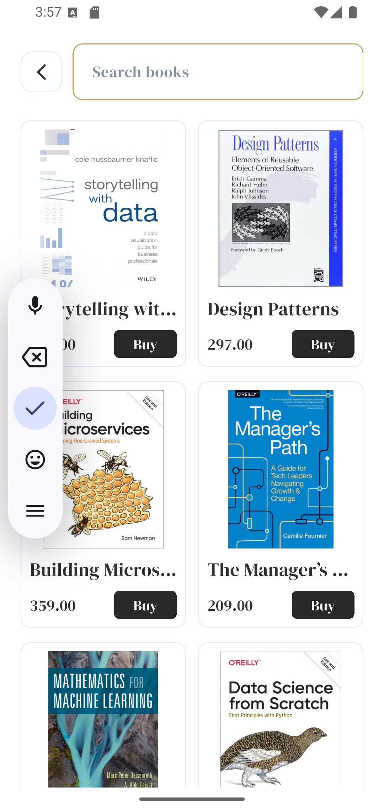
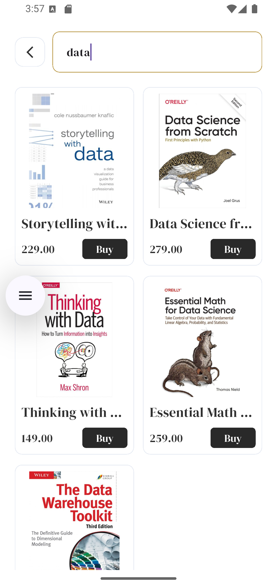

📚 Bookia — Book Store App

A Flutter application for a modern book store, designed to provide a clean and user-friendly experience for browsing and discovering books.

## 📱 App Screens
<p align="center">
  
  
  
  
  
  
  
  
  
</p>
```bash
dart run build_runner build --delete-conflicting-outputs